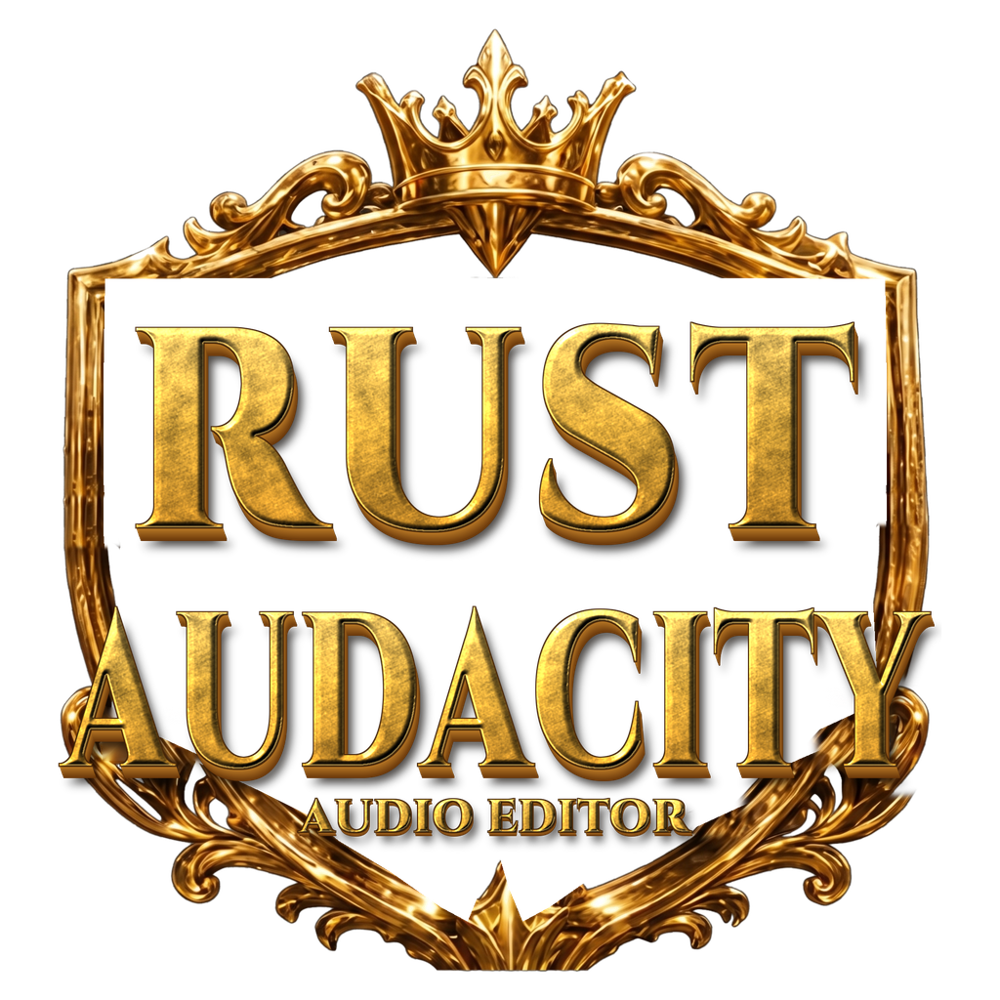

<p align="center"></p>

# Rust Audacity

An Audacity-style audio editor written in Rust. It uses
[egui/eframe](https://github.com/emilk/egui) for the UI, [cpal](https://github.com/RustAudio/cpal) for audio I/O,
[Symphonia](https://github.com/pdeljanov/Symphonia) for decoding, [hound](https://github.com/ruuda/hound) for WAV writing,
[realfft](https://github.com/HEnquist/realfft) for FFTs and [ebur128](https://github.com/sdroege/ebur128) for loudness.

## Build & run (Windows)

1. Install Rust from <https://rustup.rs> (pick the default MSVC toolchain).
2. In this folder:

   ```powershell
   cargo run --release
   ```

   You can also pass files to open: `cargo run --release -- song.mp3 voice.wav`.
   The finished program is `target\release\rust_audacity.exe`.

   To get a desktop shortcut with the app icon, double-click **`Create Desktop Shortcut.bat`**. It builds the app first if needed.

On Linux you also need `libasound2-dev`, `libgtk-3-dev` and `libxkbcommon-dev`.

## Features

### Core editor

- **Import:** WAV, MP3, FLAC, OGG, M4A/AAC, AIFF and more. Use drag & drop or File ▸ Import.
- **Export:** WAV as 16-bit PCM (dithered), 24-bit PCM or 32-bit float.
- **Playback:** play, pause, stop, loop, and click the timeline to play from that point.
- **Recording:** records from the microphone, with overdub.
- **Editing:** cut, copy, paste, delete, silence, trim, duplicate and split, with 100-step undo.
- **Tracks:** multiple tracks with gain, pan, mute and solo.

### Audio enhancement (20 features)

Every effect works on the selected tracks over the time selection, or on whole tracks if nothing is selected.

| # | Category | Feature | Where |
|---|---|---|---|
| 1 | Cleanup | **Noise Reduction**: learns a noise profile, then gates it out per frequency band | Effect ▸ Cleanup |
| 2 | Cleanup | **Click & Pop Removal**: finds clicks and rebuilds the waveform across them | Effect ▸ Cleanup |
| 3 | Cleanup | **Hum Removal**: 50/60 Hz notches plus harmonics | Effect ▸ Cleanup |
| 4 | Cleanup | **De-Esser**: split-band sibilance control | Effect ▸ Cleanup |
| 5 | Cleanup | **Clip Repair**: rebuilds flattened peaks | Effect ▸ Cleanup |
| 6 | Dynamics | **Compressor**: threshold, ratio, attack, release, soft knee, make-up | Effect ▸ Dynamics |
| 7 | Dynamics | **Limiter**: look-ahead brick-wall limiter that never goes over the ceiling | Effect ▸ Dynamics |
| 8 | Dynamics | **Noise Gate**: threshold, reduction, attack, hold, release | Effect ▸ Dynamics |
| 9 | Dynamics | **Loudness Normalize (LUFS)**: EBU R128, with −14/−16/−23 presets and an optional −1 dB limiter | Effect ▸ Dynamics |
| 10 | EQ & Tone | **Graphic EQ**: 10 bands, live response curve, 8 presets | Effect ▸ EQ & Tone |
| 11 | EQ & Tone | **Bass & Treble**: shelving tone controls | Effect ▸ EQ & Tone |
| 12 | EQ & Tone | **Distortion**: soft, hard, tube and fuzz | Effect ▸ EQ & Tone |
| 13 | Time & Pitch | **Change Pitch** without changing speed | Effect ▸ Time & Pitch |
| 14 | Time & Pitch | **Change Tempo** without changing pitch (WSOLA) | Effect ▸ Time & Pitch |
| 15 | Space | **Reverb**: Freeverb-style; the tail rings out over the audio that follows | Effect ▸ Space & Stereo |
| 16 | Space | **Stereo Widener**: mid/side width plus mid and side levels | Effect ▸ Space & Stereo |
| 17 | Separation | **Stem Separation**: vocals, drums, bass, other (and guitar/piano) | Stems ▸ Separate Stems… |
| 18 | Analysis | **Spectrogram View**: log-frequency heat map for each track | "Spectrum" button on each track |
| 19 | Analysis | **Plot Spectrum & Loudness Stats**: FFT plot with note read-out, LUFS, LRA, true peak, RMS, crest factor, DC offset | Analyze menu |
| 20 | Workflow | **Effect Preview & Effect Chains**: ▶ Preview in every dialog; chains run several effects as one undo step | Effect ▸ Effect Chains… |

Effect dialogs remember your last settings.

### Noise Reduction: two steps

1. Select a few seconds of noise only (room tone between words) and open Effect ▸ Cleanup ▸ Noise Reduction.
2. Click **Get Noise Profile**.
3. Select the audio to clean, or nothing to clean the whole track, and click **OK**.

### Stem separation

Use **Stems ▸ Separate Stems…** and pick an engine:

- **Demucs AI (recommended).** This runs Meta's open-source Hybrid Transformer Demucs model:
  - `htdemucs`: 4 stems (vocals, drums, bass, other).
  - `htdemucs_ft`: 4 stems, slower but better.
  - `htdemucs_6s`: 6 stems, adding guitar and piano.

  The "Vocals + Instrumental" option gives 2 stems. Each stem becomes a new track at the right time position, and the original track is muted.

  **One-time setup:** install Python 3, then run

  ```powershell
  pip install -U demucs
  ```

  The default command is `python -m demucs`. You can change it in the dialog, for example to a full path like `"C:\Python312\python.exe" -m demucs`. Demucs downloads its model (about 80 MB) the first time you use it. On a CPU it takes roughly as long as the song; an NVIDIA GPU is much faster. If Demucs reports an error, the dialog shows its last output lines.
- **Built-in.** This is instant and needs no install. It produces Vocals + Instrumental using spectral centre extraction: per frequency bin, sound that is identical in left and right within the vocal range goes to the vocal stem. It only works on stereo mixes with a centre-panned vocal.

**Stems ▸ Quick Vocal Remover** is the classic karaoke trick. It cancels the centre of the mix while keeping the bass.

### Built-in effect chains

| Chain | Steps |
|---|---|
| Podcast Voice | High-pass 80 Hz → Gate → De-ess → Compress 3:1 → −16 LUFS |
| Clean Up Voice Recording | Hum removal → Click removal → High-pass → Voice EQ → Normalize |
| Music Master (Streaming) | High-pass 25 Hz → Gentle 2:1 compression → −14 LUFS |
| Vinyl Restoration | Click removal → Hum removal → Rumble filter → Normalize |
| Karaoke | Vocal remover → −14 LUFS |
| Lo-Fi Radio | Band-limit 300–3400 Hz → Soft distortion → Normalize |

To change a built-in chain, click **Duplicate to edit**. You can reorder steps, change each step's settings and add steps. Your own chains are saved automatically.

## Use it from AI agents (MCP server)

`rust_audacity_mcp` is a second program built from the same engine. It lets AI agents such as Claude Desktop, Claude Code and Cursor analyze, clean up, edit, convert, mix and stem-separate audio files.

```powershell
cargo build --release --bin rust_audacity_mcp
```

Setup and the full tool list are in [MCP.md](MCP.md).

To use a **local Ollama model** instead, run `rust_audacity_chat --model qwen3:8b --root <your audio folder>`. See [MCP.md › Use it with Ollama](MCP.md#use-it-with-ollama-local-models).

## Keyboard shortcuts

| Key | Action |
|---|---|
| Space / P / R / L | Play–Stop / Pause / Record / Loop |
| Ctrl+Z, Ctrl+Y | Undo, Redo |
| Ctrl+X / C / V, Delete | Cut / Copy / Paste, Delete |
| Ctrl+L / T / D / A | Silence / Trim / Duplicate / Select all |
| Ctrl+1 / Ctrl+3 / Ctrl+E / Ctrl+F | Zoom in / out / to selection / fit |
| Ctrl+Shift+I / Ctrl+Shift+E | Import / Export |

## Code layout

```
src/
  lib.rs             audio engine library shared by the app and the MCP server
  bin/rust_audacity_mcp/  MCP server (main.rs = protocol, tools.rs = tools)
  bin/rust_audacity_chat.rs  terminal chat that connects an Ollama model to the MCP server
  main.rs            window setup
  app.rs             main UI: menus, transport, tracks, waveform/spectrogram, dialogs
  app/fx_ui.rs       effect dialogs with Preview, Effect Chains editor
  app/analyze_ui.rs  spectrum plot and loudness statistics window
  app/stems_ui.rs    stem separation dialog and background job
  effects.rs         effect catalogue (serialisable), render/apply/preview/chains
  ui_effects.rs      parameter editors for every effect
  spectrogram.rs     spectrogram rendering and texture cache
  dsp/
    stft.rs          FFT/STFT analysis and resynthesis (realfft)
    denoise.rs       noise-profile spectral gate
    restore.rs       click removal, hum notches, clip repair
    dynamics.rs      compressor, limiter, gate, de-esser
    tone.rs          graphic EQ, bass/treble, distortion
    biquad.rs        RBJ cookbook filters
    stretch.rs       WSOLA time-stretch, pitch shift
    space.rs         reverb, stereo width, vocal remover
    analysis.rs      LUFS/LRA/true-peak, spectrum
    separation.rs    built-in centre extraction, Demucs runner
  project.rs, track.rs, engine.rs, fileio.rs, waveform.rs
```

Run `cargo test` to run the 48 unit tests. They cover every DSP block, for example: the limiter never exceeds its ceiling, noise reduction lowers noise while keeping a tone, pitch shift doubles the frequency without changing the length, separated stems sum back to the original, and the Demucs command is checked with a stand-in script.

## Known limitations

- Effects run on the UI thread, so heavy effects (tempo/pitch, noise reduction) on long files pause the window for a moment. Stem separation runs in the background.
- Resampling uses linear interpolation.
- Not built yet: project save/load, MP3/FLAC export, clip dragging, labels and envelopes, and choosing audio devices.
